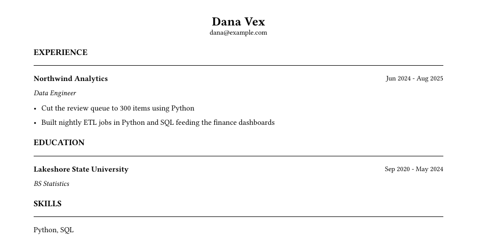

# callback

Tailoring a resume or cover letter for a specific role is high-effort, low-feedback work, and
generic language-model assistance leaves the dangerous part unchecked: nothing stops it inventing
an accomplishment or inflating a title, and nobody has checked that an applicant-tracking system
can read what it produces.

`callback` is a Claude Code plugin built the other way round. The candidate's facts live in a local,
provenance-tracked store; Claude arranges them for a posting; and a deterministic Python package
checks every document mechanically against that store before it is delivered. A quality claim is
something you can re-run, not something the model reports about itself. There is no LLM call in
`core/`.

## What the checks guarantee

| Property | Mechanism |
|---|---|
| Only facts the candidate confirmed can back a document | `callback facts confirm` reads its answers from the controlling terminal, not from input a program can pipe in; a write-guard hook refuses an assistant's edits to the fact store and its attempts to run confirm through a wrapper that fakes a terminal. This stops accidents and a model steered by a posting; it is not a boundary against a program built to get round it (`docs/limitations.md`) |
| Bullets make no claim their facts do not state | every number (including spelled-out ones), date, technology, mid-sentence name and claim word (award, promoted, doubled, …) must appear in the cited facts; a count cannot rest on a percentage |
| Entry headers are not inflated | every header field an entry prints (employer, title, location, dates) must equal the same cited fact's; a bullet may cite only its own entry's facts |
| Nothing is added around the content | the identity block must match a confirmed contact fact; section titles come from a fixed list; every listed skill needs confirmed backing |
| The PDF is machine-readable | the rendered PDF is re-extracted with a deliberately naive parser, and every critical field must be recovered in order |
| Nothing hidden | no invisible, tiny, off-page or unpainted text, no suspicious Unicode, no unexpected metadata; anything the screen cannot judge fails rather than passes |
| Cover letters stay honest | each sentence declares what it is about: claims about the candidate rest on their facts and never on the posting, names, numbers and claim words about the employer only on the posting; commitment language (salary, availability, relocation, sponsorship) fails |
| Postings come from the source | discovery reads employers' documented public posting APIs over HTTPS, politely, and refuses LinkedIn, Indeed, Handshake, Workday and Glassdoor by name; an employer's own careers page is read only from the `schema.org/JobPosting` data it publishes, honouring `robots.txt` |
| Applications stay reasonable | at most 10 in 24 hours, no re-apply to the same posting within 90 days, and a packet is only built from a draft that passed, or whose warnings the candidate accepted |
| What was sent stays provable | a sealed document is copied read-only with a signed manifest of its hashes, and every seal and application is appended to a hash-chained, keyed ledger, so a file changed afterwards, or a ledger rewritten, is detected |

It does **not** check ordinary wording: "led the migration" and "helped with the migration" are
indistinguishable to it. And it cannot know whether a fact the candidate confirmed is true. See
`docs/limitations.md` for the full list.

## What it looks like

A synthetic candidate, Dana Vex, has seven confirmed facts
(`evals/persona/home/facts.yaml`). The posting asks for Kubernetes and "measurable
impact". Here is a draft that gives it both, with one invented bullet:

```yaml
    bullets:
    - {text: Cut the review queue to 300 items using Python, sources: [queue]}
    - {text: Built nightly ETL jobs in Python and SQL feeding the finance dashboards, sources: [etl]}
    - {text: Cut model-serving latency 40% by migrating the ETL jobs to Kubernetes, sources: [etl]}
```

`callback build` renders it, runs every gate, and refuses it:

```text
$ callback build docs/example/resume.yaml --job acme-ml
FAIL  ~/.callback/outputs/acme-ml/draft/resume.pdf
  grounding  fail
  claims     fail
  roundtrip  pass
  hidden     pass
  skills     warn
  lints      pass
report: ~/.callback/outputs/acme-ml/draft/report.md
```

and the report it names opens with what to fix:

```text
## Fix first
- grounding: bullet 2: unresolved_number: '40%' is not derivable from the cited facts
- grounding: bullet 2: unknown_entity: 'Kubernetes' (canonical form 'Kubernetes') appears in no cited fact
- claims: skill 'Kubernetes' is backed by no confirmed fact
```

The PDF still exists, watermarked, in `draft/`: a document is always delivered, and
provenance decides where it lands. With the invented bullet and skill removed, the
same facts build to this, with one warning (two bullets under a role, where three
are expected):



To reproduce it, copy `evals/persona/home/` to a scratch directory, point
`CALLBACK_HOME` at it, and run the command above.

## Using it

Requires Python 3.12, [`uv`](https://docs.astral.sh/uv/) on your `PATH` (the MCP server
starts through it; without it the tools silently never appear) and Claude Code.

```bash
uv sync
claude --plugin-dir .      # loads the tailor skill, the MCP tools and the write guard
```

Then talk to Claude: *"find me ML internships"*, *"tailor my resume to this posting"*, *"what
should I do next?"*. The session calls the checks as MCP tools and reports what they said; the
command line below is the same code with an argv front end, used by the tests, by CI, and
whenever you want to run something yourself.

**One command is yours alone.** `callback facts confirm` reads your controlling terminal rather
than piped input, and the write guard refuses the assistant's attempts to run it, so making a fact
usable is your step — and a bullet may rest only on a confirmed fact. Erasing the data home is
likewise not a tool. Everything else is conversational:

| Command | Does |
|---|---|
| `callback targets add`, `criteria`, `watch`, `postings` | find postings on employers' own Greenhouse, Lever and Ashby boards and in Hacker News's "Who is hiring?", never by scraping job sites |
| `callback profile`, `eligibility`, `triage` | flag knockout requirements (sponsorship, citizenship, graduation window) quoted from the posting, and rank postings by evidence and freshness |
| `callback import resume.pdf` | extract an existing resume's text, screening it for hidden content |
| `callback facts add / list / confirm` | store facts (unconfirmed), list them, confirm them yourself |
| `callback build resume.yaml --job <id>` | render the PDF and run every gate; exit 0 pass, 1 warn, 2 fail |
| `callback letter letter.yaml` | render and check a cover letter |
| `callback export resume.yaml` | the resume as plain text, for forms that want it pasted |
| `callback answers answers.yaml` | check free-text application-form answers against their limits, ready to paste |
| `callback outreach note.yaml` | a grounded note to a recruiter, engineer or alum, within its channel's limit |
| `callback apply <id> …` | build the application packet and record it; **callback never submits** |
| `callback outcome <id> <kind>`, `callback applications`, `callback funnel` | track what happened, and the reply, callback and offer rates by where you applied |
| `callback facts github <user>` | draft unconfirmed project facts from your own public repositories |
| `callback finalize <id>` / `callback verify` | seal what you sent and prove later that nothing changed |
| `callback interview <id>` | an interview pack built from exactly the documents that were sent |

`docs/using-callback.md` has the fact format, the document format and every rule.

## Evaluating the skill

The tests check `core`. `evals/` checks the half that runs in Claude: five
cases run with and without the plugin through `claude plugin eval`. Without
it, Claude fetched a LinkedIn job page in 3 of 3 runs and told the user an
unconfirmed fact was confirmed in 3 of 3; with it, neither happened. On
fabrication both arms were clean when handed an explicit facts file, which is
why the gates exist: they catch the model that slips rather than trusting the
one that doesn't. On cover letters the plugin did no better than the baseline:
a judge faulted characterising sentences that no fact states and the letter
gate cannot check. `evals/README.md` has the table, the caveats and how to run it.

## Development

Requires Python 3.12 and [`uv`](https://docs.astral.sh/uv/).

```bash
uv sync
uv run pytest -q
uv run ruff check .
uv run ruff format --check .
uv run pyright
```

`CLAUDE.md` holds the repository's non-negotiables and the defects it has actually shipped, and
`docs/lessons/` records design decisions with their evidence.

## License

MIT — see `LICENSE`.
